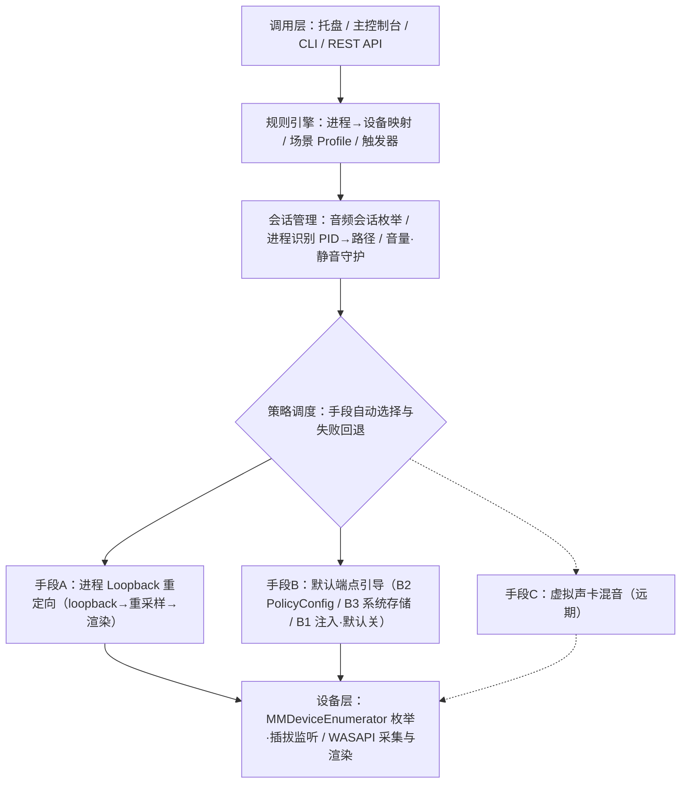

# PerAppAudio — 每应用音频输出路由工具 · 项目规划

> 版本：v2.0（2026-10-19） · 状态：**调整定稿**（主功能聚焦：每音源独立选择输出设备）
> 沿革：v0.2 A/B 双轨用户自选 → v0.3 控制手段为第一优先级 → v1.0 定稿（名称 PerAppAudio / C# 单体 / Windows 首版）→ **v2.0 主功能聚焦调整（2026-10-19）**
## 0. 本次调整（v2.0，2026-10-19）

**主功能（唯一主线）**：让不同的音源（应用程序）各自选择不同的输出设备。

一切工作按「是否强化这条主线」排序；不强化主线的一律降级为支撑或移出范围。

### 0.1 主功能的定义与闭环

| 环节 | 用户行为 | 系统动作 | 现状 |
| --- | --- | --- | --- |
| ① 看见音源 | 打开即看到当前在发声的应用 | 会话枚举（PID / 显示名） | ✅ |
| ② 选择设备 | 每个音源旁选一个输出设备 | 写入路由意图 | ✅ |
| ③ 立即生效 | 点一下就改道 | 手段A 实时迁移 + 手段B2 持久化并行 | ✅ |
| ④ 持久保持 | 重启 / 重开应用仍按选择走 | routes.json + B2 注册表 | ✅ |
| ⑤ 自动补齐 | 新开的程序按规则自动就位 | 看门狗 2s 扫描 + 设备事件触发 | ✅ |

**主功能验收标准**：任一有音频会话的应用，从列表选设备到声音改到目标设备 ≤2s；重启后保持；进程退出自动清理；任何步骤不出现「没声音」。

### 0.2 能力重排

| 层级 | 内容 | 优先级 |
| --- | --- | --- |
| 主功能 | 音源枚举 / 选设备 / 立即改道 / 持久化 / 规则自动应用 | **P0 唯一主线** |
| 支撑 | 手段A/B2 与策略调度、音量·静音、托盘、路由表、场景、设备事件 | P1（只服务主线） |
| 支撑（弱） | 日志、OSD、热键、中英界面 | P2 |
| 非目标 | 见 §0.3 | 不做 |

### 0.3 非目标清单（v2.0 明确不做）

| 项 | 原因 |
| --- | --- |
| 内置播放 / 音板（SoundPad） | 与主线无关，已于 v0.6.0 移除 |
| 驱动级接管默认麦克风 | 需 EV 签名内核驱动 / APO，超出用户态能力 |
| 手段B1 注入 | 杀软误报风险，默认关闭且不再推进 |
| 手段C 虚拟声卡 | 需 EV 签名驱动 |
| REST API / HomeAssistant 集成 | 主线用不到，暂停 |
| 每应用电平表 | 观赏性功能，暂停 |
| Linux / macOS | 远期，暂停 |
| MSIX / winget / Authenticode 签名 | 需采购证书，暂缓；绿色单文件 exe 继续 |

> v1.0 的 §1–§12 全部保留为历史依据；后续迭代只按 §0 的主功能闭环验收。


## 1. 项目定位

**一句话：让每个应用程序独立选择音频输出设备，打破"所有声音只有一个默认输出"的系统限制。**

**产品本质：一个「音频走向控制引擎」。** 第一优先级不是界面、不是规则自动化，而是**控制音频走向的手段**——把指定应用的音频可靠地引向指定输出设备的能力（指定设备、独立音量 / 静音、运行中动态改道）。手段 A / B / C 是产品核心；手段选择、规则、场景、UI 只是调用层。

| 项 | 内容 |
| --- | --- |
| 核心价值 | 游戏走音箱、会议走耳机、音乐走蓝牙，互不干扰、独立调音量 |
| 项目名称 | **PerAppAudio**（仓库 per-app-audio，MIT） |
| 目标平台 | Windows 10 2004+ / 11（首版唯一平台）；Linux (PipeWire)、macOS 远期 |
| 开源协议 | MIT（利于生态与二次分发） |
| 分发方式 | 绿色版 + MSIX/WinGet；Authenticode 签名规避 SmartScreen 拦截 |
| 隐私承诺 | 纯本地运行、零网络请求、无遥测（开源信任基础） |

**开发优先级声明**：

| 层级 | 内容 | 优先级 |
| --- | --- | --- |
| 控制手段层 | 手段A 流重定向 / 手段B 端点重定向 / 手段C 虚拟设备；策略调度与失败回退 | **P0 核心** |
| 调用层 | 主控制台、托盘、CLI、规则、场景、触发器 | P1 次要 |

**痛点**：Windows 11 虽在「设置 › 系统 › 声音 › 应用音量和设备首选项」提供每应用输出选择，但覆盖不全、无法自动切换、无规则引擎、无独立音量持久化；Windows 10 无此能力。

**对标分析**：

| 产品 | 类型 | 优点 | 不足 |
| --- | --- | --- | --- |
| VoiceMeeter | 免费闭源 | 成熟稳定、虚拟混音 | 需手动搭跳线、无自动规则、界面复杂 |
| CheVolume | 闭源收费 | 每应用设备切换 | 收费、不透明、无规则引擎 |
| EarTrumpet | 开源 | UI 好、每应用音量 | 依赖 Win11 部分能力、无自动规则（待调研） |
| Audio Router | 开源（停更） | 轻量 | 依赖未公开 API、仅旧系统、已废弃 |
| PipeWire (Linux) | 系统原生 | 完整 per-app 路由 | 仅限 Linux |

## 2. 需求分析

### 2.1 核心需求：音频走向控制能力

手段之间的差异即产品差异，用控制能力矩阵刻画（**v1.0：A/B 两列已填入 P0 实测数据**）：

| 控制能力 | 手段A 流重定向 | 手段B 端点重定向 | 手段C 虚拟设备 |
| --- | --- | --- | --- |
| 指定应用 → 指定输出设备 | ✅ 实测通过 | ✅ 实测通过（注册表实锤） | ✅ 理论 |
| 目标设备上独立音量 / 静音 | ✅ 实测通过 | ✅ 随端点切换 | ✅ 理论 |
| 运行中动态改道（正在播放的应用） | ✅ 实测通过（0 丢帧） | ❌ **实测不支持**：只持久化每程序路由，应用创建新音频会话时才生效 | ✅ 理论 |
| 端到端延迟 | 实测 ≈20ms+（采集 10ms + 渲染 10ms + 处理 0.02ms） | 不适用（无音频搬运，应用原生路径直出） | < 10ms 理论 |
| CPU 开销 | 实测 0.08%/路 | 实测 ≈0（仅一次 COM 调用） | 理论低 |
| 对宿主应用侵入 | 无（公开 API） | 无（未公开接口，无注入） | 无 |
| 系统 / 驱动要求 | Win10 2004+ 实测 | **Win10 21H2+ / Win11** 实测（B2） | EV 签名驱动 |
| 音质损失 | 轻度重采样（请求 plain float 格式时可零转换） | 原生 | 原生 |
| 路由持久化（重启后保持） | ❌ 运行期状态 | ✅ 每程序持久化（注册表） | ✅ |
| API 稳定性 | 高（全公开 API） | ✅ **P1 破案**：仅目标进程已注册音频会话时可写（播放中/播放过/explorer 15/15+3/3 全成功）；无会话或已退出进程 E_INVALIDARG（合理语义，非不稳定）。重试吸收并发竞争与启动注册窗口 | 高 |

**产品结论（P0 实测得出）**：手段B2 管「未来」——应用启动即按路由走，零开销、持久化；手段A 管「现在」——正在播放的应用实时改道，零丢帧。两者组合覆盖全部场景，策略调度默认「自动」= B2 持久化 + A 实时迁移双管齐下。

### 2.2 调用层需求（次要）

| 优先级 | 功能 |
| --- | --- |
| P0 | 手段选择：A / B / 自动（可按应用覆盖） |
| P1 | 主控制台（每应用设备 / 音量 / 手段）、托盘快捷切换 |
| P1 | 场景 Profile 一键切换；设备插拔自动路由 |
| P2 | 定时 / 前台窗口触发规则；CLI + REST API |
| P3 | 每应用电平表；Linux / macOS 适配 |

### 2.3 非功能需求

| 项 | 指标 |
| --- | --- |
| 延迟 | 手段A ≤ 60ms；手段B < 10ms（双档并存） |
| CPU | 单路音频路由 < 3% |
| 稳定性 | 进程退出自动清理；手段B 失败 2 秒内自动回退手段A |
| 兼容 | Win10 2004+；共享 / 独占模式混合环境可降级 |

### 2.4 已知边界（诚实清单，需在文档与 UI 明示）

- 浏览器多标签同属一个进程，无法按标签拆分（Chrome 音频线程模型限制）；
- 系统提示音归属 Explorer.exe，需内置「系统声音」特殊规则；
- UWP / 沙盒应用音频宿主进程特殊，需 PoC 实测后列入支持 / 不支持清单；
- 独占模式应用：手段A 无法捕获；手段B 可尝试，需实测。

## 3. 总体架构

五层分层架构，MVP 全程用户态运行，无内核驱动：



| 层 | 职责 | 关键 Windows API |
| --- | --- | --- |
| 调用层 | 托盘、主控制台、CLI、REST API（规则引擎亦属调用层） | — |
| 会话管理 | 枚举音频会话、PID→可执行路径 / 签名识别、音量与静音守护 | IAudioSessionManager2、ISimpleAudioVolume、IAudioSessionEvents |
| 控制手段层 | 手段A 管线、手段B 端点引导、**策略调度**（自动选择 + 回退） | ActivateAudioInterfaceAsync（AUDIOCLIENT_ACTIVATION_PARAMS）、IAudioClient / IAudioCaptureClient / IAudioRenderClient；B2/B3 见 §4.2 |
| 设备层 | 设备枚举、插拔监听、采集与渲染 | IMMDeviceEnumerator、IMMNotificationClient |

## 4. 控制手段设计（A/B 双轨 + C 预留）

### 4.1 手段对比

| 维度 | 手段A：进程 Loopback 重定向 | 手段B：默认端点引导 | 手段C：虚拟声卡混音 |
| --- | --- | --- | --- |
| 原理 | 进程级 loopback 捕获 → 原会话静音 → 渲染到目标设备 | 把应用的默认输出端点改为目标设备，应用直接播放 | 多条虚拟音频线 + 混音引擎按规则分派 |
| 端到端延迟 | 30–60ms | < 10ms | < 10ms |
| 驱动 / 签名 | 无，纯用户态 | B2/B3 无；B1 注入有杀软风险 | 需 EV 签名驱动，或依赖用户已装 VB-Cable |
| 音质 | 共享格式 48kHz，轻度重采样 | 原生 | 原生 |
| 稳定性 | 高（全公开 API） | 中（依赖未公开接口 / 系统行为） | 高 |
| 适用场景 | 通用兜底（游戏语音、音乐、会议） | 低延迟竞技游戏、实时语音 | 专业音频、多设备混音 |

### 4.2 手段B 的三个候选实现（P0 实测后定主推）

| 子方案 | 做法 | 优点 | 风险 |
| --- | --- | --- | --- |
| B1 注入 Hook | 向目标进程注入 DLL，Hook IMMDeviceEnumerator::GetDefaultAudioEndpoint | 延迟最低、控制最细 | 杀软误报、Win11 兼容性、进程重启需重注 |
| B2 IPolicyConfig 接口 | 调用未公开的 PolicyConfig 系列 COM 接口设置每进程默认端点（SoundVolumeView 已有先例） | 无注入、无杀软问题、延迟低 | 接口未文档化，需版本兼容探测 |
| B3 Win11 系统 per-app 存储 | 引导 Win11 22H2+ 自带的每应用端点持久化 | 最稳、官方行为 | 仅 Win11 22H2+，存储位置未公开 |

**推荐**：B2 主推，B3 验证后并入，B1 作为高级选项**默认关闭**（UI 明示风险）。

### 4.3 策略调度（手段选择与回退）

- 全局默认「**自动**」：优先尝试 B；探测失败 / 不支持 → 自动回退 A；
- 每应用可强制指定：`A` / `B` / `自动`；
- 自动判定因素：手段B 可用性探测、进程类型（UWP / 独占 → A）、用户延迟偏好；
- **安全网**：B 设置后 2 秒内目标设备未出现该应用会话（或播放异常）→ 自动切 A 并通知用户。产品在任何情况下不会"没声音"。

## 5. 技术选型

| 层 | 选型 | 理由 |
| --- | --- | --- |
| 语言 | C# / .NET 8 | WASAPI P/Invoke 生态成熟、迭代快；核心引擎接口化，便于后续换 C++/Rust |
| 音频 | 自研 WASAPI 封装（NAudio 备用） | 进程级 loopback 与 PolicyConfig 均需手写互操作，现有库覆盖不足 |
| UI | WPF 先行，Avalonia 作跨平台储备 | Windows 优先 |
| 配置 | YAML 规则文件 + SQLite 运行时状态 | 人类可读、可 Git 版本管理 |
| 分发 | MSIX + winget manifest | 现代安装体验 |
| CI | GitHub Actions | 自动构建 / 测试 / 发布 |

### 5.1 语言栈决策：C# 单体 vs C++ 核心

| 维度 | C# 单体（.NET 8 全栈） | C++ 核心 + C# UI |
| --- | --- | --- |
| 开发速度 | 快 2–3 倍：单语言、单工具链、UI 与引擎零边界 | 慢：跨语言边界（C++/CLI / COM / P/Invoke 包装各有坑） |
| UI 生态 | WPF 数据绑定 / 托盘 / 动画开箱即用 | UI 层仍要 C#，核心另起一套 |
| 内存安全 | GC + 边界检查，崩溃风险低 | 全靠自己：泄漏 / UB / 爆音难查 |
| 延迟确定性 | GC 停顿需用对象池 / ArrayPool 规避 | 无 GC，线程优先级 / 锁-free 精细可控 |
| Windows API 适配 | WASAPI 需 P/Invoke，结构体 / vtable 顺序易错 | WASAPI / COM 原生 ABI 直调，零摩擦 |
| 手段 B1 注入 | 原生 DLL 才行；C# 注入需 CLR 宿主，杀软更敏感 | 唯一自然选择 |
| 性能上限 | 热点可 System.Numerics SIMD，后期抽原生库 | SIMD intrinsics 精调，CPU 更低 |
| 分发 | 需 .NET 运行时（自包含发布约 +70MB） | 原生 exe 无运行时依赖 |
| 贡献者门槛 | 低，C# 基数大 | 高 |
| 手段 C 扩展 | 不可行（驱动需 C） | 唯一路径（WDK 是 C） |

**结论（v1.0 已定稿）**：本项目是「控制流密集」而非「计算密集」——三种手段的核心动作是设置端点、启停会话、搬移缓冲区，延迟瓶颈在 Windows 音频栈本身而非语言；叠加单人开发 + 开源贡献生态，C# 快 2–3 倍。**定稿：C# 单体先行**：控制手段层以 `IRoutingBackend` 接口抽象，后期把重采样热点与 B1 注入模块抽为原生库经 P/Invoke 加载——两条路的优点都能拿到。

## 6. 功能详设（按优先级重排）

### 6.1 手段A：音频管线（P0 核心）

- 采集：进程级 Loopback（Win10 2004+，`ProcessLoopbackMode = INCLUDE_TARGET_PROCESS_TREE`）；
- 缓冲：10ms 共享缓冲 + 事件驱动 + 无锁环形队列；
- 转换：内部统一 float32 / 48kHz，输出端按目标设备格式重采样、声道映射、爆音保护；
- 降级：目标设备被独占占用时优雅提示，不崩溃。

### 6.2 手段B：端点引导器（P0 核心）

- 能力探测：启动时探测 B2/B3 接口可用性与系统版本，写入「本机能力表」；
- 设置：对目标进程设置默认输出端点；验证 2 秒内目标设备出现该应用会话；
- 回退：验证失败或后续异常 → 自动切手段A 并通知；
- B1 注入：默认关闭，设置页明示杀软风险后可由用户手动开启。

### 6.3 策略调度（P0 核心）

- 手段选择：按 §4.3 规则决定每个应用使用哪种手段；
- 状态机：应用中 → 已改道 → 守护中 → 异常回退 → 已清理；
- 冲突解决：同一应用多条规则命中时，精确路径 > 进程名 > 通配符，后者让位。

### 6.4 会话管理器（P0 依赖）

- 枚举：IAudioSessionEnumerator 遍历设备会话，取 PID、DisplayName、IconPath；
- 识别：PID → 可执行路径 → 签名校验；规则绑定**路径 / 签名**而非 PID（抗进程重启）；
- 守护：应用可能自行重置音量 / 取消静音，需 500ms 内轮询纠正 + 监听 IAudioSessionEvents；
- 生命周期：会话断开、进程退出自动拆除路由，无残留。

### 6.5 规则引擎与场景（P1 调用层）

```yaml
version: 1

# 全局默认手段：auto = 优先 B，失败自动回退 A
default_mode: auto

# 设备别名：避免设备名随接口编号漂移（ID 可在软件内一键填充）
devices:
  speaker: "{0.0.0.00000000}.{xxxxxxxx-xxxx-xxxx-xxxx-xxxxxxxxxxxx}"
  headset: "Realtek HD Audio 2nd output"

profiles:
  - name: "游戏场景"
    rules:
      - match:
          process_path: "C:\Riot Games\VALORANT\live\VALORANT-Win64-Shipping.exe"  # 精确路径 > 进程名 > 通配符
          # 也可写: process: "*.exe" / window_title: "*Valorant*"
        action:
          device: speaker
          mode: auto          # auto / loopback(强制A) / endpoint(强制B)
          volume: 0.8         # 0.0–1.0
          mute: false
      - match: { process: "Discord.exe" }
        action: { device: headset, mode: endpoint, volume: 0.6 }   # 语音软件强制走 B（低延迟）
    triggers:
      - type: device_connected
        device_name: "*Headset*"
      - type: process_started
        process: "steam.exe"

  - name: "工作场景"
    rules:
      - match: { process: "chrome.exe" }
        action: { device: headset, mode: auto, volume: 1.0 }
      - match: { process: "explorer.exe" }     # 系统提示音
        action: { device: speaker, mode: loopback }
```

| 字段 | 取值 | 说明 |
| --- | --- | --- |
| `default_mode` | `auto` / `loopback` / `endpoint` | 全局默认；`auto` = 优先 B、失败回退 A |
| `match` | `process_path` / `process` / `window_title` | 匹配优先级：路径 > 进程名 > 通配符 |
| `action.device` | 设备别名 / 设备 ID / 设备名 | 别名在 `devices` 段定义 |
| `action.mode` | `auto` / `loopback` / `endpoint` | 覆盖全局手段；`loopback` = 强制 A，`endpoint` = 强制 B |
| `action.volume` / `mute` | 0.0–1.0 / true·false | 该应用在目标设备上的音量与静音 |
| `triggers` | 见示例 | 满足任一条件时自动切换到该 Profile |

### 6.6 CLI / REST（P2 调用层）

本地 HTTP API + 命令行，供脚本与 HomeAssistant 集成；P1 阶段只做内部调试用最小命令集。

## 7. 关键技术难点与对策

| 难点 | 对策 |
| --- | --- |
| 进程级 loopback 仅支持 Win10 2004+ | 明确最低系统版本，老系统启动即提示 |
| B2/B3 未公开接口，版本差异大 | P0 做版本矩阵实测（Win10 2004/22H2、Win11 23H2/24H2）；调用前能力探测；失败即回退 A |
| 应用自行重置音量 / 静音 | 守护轮询 + IAudioSessionEvents 事件纠正 |
| 延迟累积（采集 + 重采样 + 渲染） | 10ms 缓冲 + 事件驱动；提供低延迟档位 |
| 源 / 目标设备格式不一致（44.1k vs 48k vs 独占） | 内部 float32 统一格式，输出端重采样 |
| Chrome 等进程频繁重启 | 规则绑定可执行路径 + 证书签名 |
| UWP / 沙盒应用宿主进程 | PoC 阶段实测，失败列入「不支持清单」 |
| 系统声音归属 Explorer | 内置「系统声音」虚拟会话特殊处理 |

## 8. 路线图（按手段优先级重排）

| 阶段 | 周期 | 目标 | 验收标准 |
| --- | --- | --- | --- |
| P0 手段验证 | 1–2 周 | 三种手段的控制能力实测 | 《控制手段可行性报告》：A 延迟 < 60ms、CPU < 3%、无爆音；B 至少一种子方案在 ≥ 2 个系统版本生效且 < 10ms；控制能力矩阵填写完毕 |
| P1 控制闭环 | 3–4 周 | 最小可用走向控制：指定应用 → 指定设备、可动态改道、策略调度与自动回退 | 单应用改道成功率 ≥ 99%；B 失败 2s 内回退 A；UI 仅保留必要控件 |
| ~~P1 控制闭环~~ | **已完成（2026-10-16）** | RoutingCoordinator（Auto=B2+A 并行）+ RouteStore 持久表 + 看门狗 + ctl CLI | **实测达标**：B2 set 15/15（播放中）；Auto 并行无串行回退延迟（B2❌A✅ 音频不中断）；进程退出拆除 1–2s；重启路由保持（注册表+routes.json）；新进程 2–4s 自动应用；**E_INVALIDARG 破案**（见 §12 P0-2 定论） |
| ~~P2 调度层~~ | **已完成（2026-10-18）** | 规则引擎 / 场景 Profile / 设备事件触发 / WPF 托盘壳 / 单文件发布（v0.5.0–v0.6.1） | 一键切换 167ms；设备插拔触发 800ms 防抖；音板方向已于 v0.6.0 放弃（D5） |
| **P2' 主功能强化（v2.0）** | 进行中（2026-10-19） | 按 §0.1 五环节逐项强化：① 音源可见性（winmm 会话盲区替代方案）② 选择体验（通配符 / 设备别名 / `default_mode`）③ 立即生效 ≤2s ④ 持久化 ⑤ 规则自动应用 | 主功能闭环五环节全部实测达标；补齐 §6.5 规则 DSL 缺口 |
| ~~P3 发布~~ | **部分完成（2026-10-19）** | 文档 / 单文件绿色 exe 已完成；Authenticode 签名、MSIX、winget、CI 暂缓（D6） | 绿色 exe 即用；签名与安装器按需再启动 |
| P4 远期 | 待定 | 手段C、Linux (PipeWire) / macOS、插件化 | — |

## 9. 风险与缓解

| 风险 | 等级 | 缓解 |
| --- | --- | --- |
| B 全部子方案失效（系统更新） | 中 | A 兜底保证产品始终可用；B 失败自动回退；接口调用全部包版本探测 |
| 注入方案杀软 / Defender 误报 | 中 | B1 默认关闭，UI 明示风险；主推 B2 无注入 |
| Windows 更新破坏 API | 中 | 只用公开 API + 版本探测降级 |
| 调用层功能蔓延拖慢核心 | 中 | P1 严格限定 UI 最小集；调度层功能全部排到 P2 |
| 单人维护精力不足 | 高 | 范围克制：P1 只做手段A 全功能 + 手段B2 最小可用 |
| 法律合规 | 低 | MIT；无专利算法；不逆向私有协议 |

## 10. 仓库结构（建议）

```
per-app-audio/
├── src/
│   ├── RoutingEngine/    # 控制手段层：手段A管线 / 手段B端点引导 / 策略调度
│   ├── SessionManager/   # 会话枚举、进程识别、音量守护
│   ├── RuleEngine/       # 规则匹配、场景、触发器（调用层）
│   ├── App.Wpf/          # 托盘与主界面（调用层）
│   └── App.Cli/          # CLI / REST（调用层）
├── tests/                # 单元测试 + 回环集成测试
├── docs/                 # 架构文档、规则 DSL、贡献指南
└── .github/workflows/    # CI
```

## 11. 决策记录（v1.0 定稿）

| # | 决策项 | 结论 | 日期 |
| --- | --- | --- | --- |
| D1 | 项目名称 | **PerAppAudio** | 2026-10-15 |
| D2 | 技术栈 | **C# 单体先行**（.NET 8 全栈）；控制手段层抽象 `IRoutingBackend`，重采样热点与 B1 注入模块后期抽原生库 P/Invoke 加载 | 2026-10-15 |
| D3 | 首版平台 | **仅 Windows 10 2004+ / 11**；Linux (PipeWire) / macOS 远期 | 2026-10-15 |
| D4 | 主功能聚焦 | **「每音源独立选择输出设备」为唯一主线**，其余能力按是否强化主线重排（见 §0） | 2026-10-19 |
| D5 | 放弃内置播放 | 移除音板 / 编辑器 / 混音路由 / 麦克风接管（v0.6.0），与主线无关 | 2026-10-19 |
| D6 | 非目标清单 | 音板、驱动级接管麦克风、B1 注入、手段C、REST API、电平表、跨平台、MSIX/winget 全部移出范围（见 §0.3） | 2026-10-19 |

## 12. P0 启动清单（按序执行）

1. **建仓**：本地 git 初始化，MIT LICENSE，README 骨架（已完成，见仓库根目录）；
2. **脚手架**：.NET 8 solution，项目 `WasapiInterop` / `RoutingEngine`（`IRoutingBackend` + 手段A）/ `SessionManager` / `RuleEngine` / `App.Wpf` / `App.Cli`（已完成，`dotnet build` 0 警告 0 错误）；
3. **PoC-1（手段A）**：**已完成**（2026-10-15，Win11 build 26200 实测）——进程级 loopback 捕获 → 渲染到第二设备全链路打通；实测见下表；
4. **PoC-2（手段B2）**：**已完成**（2026-10-15，Win11 build 26200 实测）——`IAudioPolicyConfigFactory` 绑定成功，`SetPersistedDefaultAudioEndpoint` 持久化成功（注册表实锤）；发现语义限制与间歇性问题，详见下节；
5. **产出《控制手段可行性报告》**，回填 §2.1 控制能力矩阵，定 P1 范围。

**PoC-1 实测记录**（测试音 440Hz 从默认设备 XIBERIA K03S 播放，改道至 VoiceMeeter VAIO3）：

| 指标 | 实测值 | 目标 | 结论 |
| --- | --- | --- | --- |
| CPU 占用 | 0.08%（16 逻辑核折算） | <3% | 达标 |
| 丢帧 / 不连续（爆音） | 0 / 0 | 0 | 达标 |
| 实时率 | 100.2% | ~100% | 达标 |
| 单包处理耗时 | avg 0.018ms / max 1.876ms | — | 可忽略 |
| 拆除后恢复 | 原会话正常恢复 | — | 达标 |
| 缓冲配置 | 采集 10ms(480帧) + 渲染 10ms(1056帧) | — | 端到端约 20ms+ |

**PoC-1 排障记录（重要经验，避免复发）**：

| 现象 | 根因 |
| --- | --- |
| 0xC0000005 AccessViolation @ IMMDevice.GetId | COM 接口 vtable 方法顺序写错：真实顺序是 Activate → **OpenPropertyStore** → GetId → GetState（我最初把 GetId/GetState 写在 OpenPropertyStore 前） |
| 0x88890011 AUDCLNT_E_EXCLUSIVE_MODE_ONLY @ Loopback Initialize | ① 请求了设备的 Extensible Mix 格式——Loopback 虚拟设备只接受普通 WAVEFORMATEX；② 缺少 AutoConvertPcm/SrcDefaultQuality 标志 |
| 0x80070057 E_INVALIDARG @ Loopback Initialize | plain 格式结构体构造后未 Marshal.StructureToPtr 进 formatPtr，仍传了 Extensible 裸指针 |
| 0xC0000005 AccessViolation @ IAudioCaptureClient.GetBuffer | Win8+ 的 GetBuffer 有 **5 个参数**（后两个 out ulong 设备位置/QPC 走栈），少声明两个 out 参数导致原生代码往调用方栈帧垃圾位置写值 |

### PoC-2 手段B2 实测记录（每进程默认端点，免注入）

**机制确认**（与 EarTrumpet / Windows 现代声音设置同款）：
- 不是 COM 类 `CPolicyConfigClient`（那个只有全局 SetDefaultEndpoint），而是 WinRT 内部类 `Windows.Media.Internal.AudioPolicyConfig` 的**激活工厂** `IAudioPolicyConfigFactory`；
- `RoGetActivationFactory` 绑定；IID `ab3d4648-e242-459f-b02f-541c70306324`（Win10 21H2+ / Win11）；接口 IInspectable 派生，25 个槽位后是 set/get 方法；
- 设备 ID 必须包装为 `\\?\SWD#MMDEVAPI#{endpointId}#{e6327cad-dcec-4949-ae8a-991e976a79d2}`；
- 持久化位置：`HKCU\Software\Microsoft\Multimedia\Audio\DefaultEndpoint\{hash}_0`，值 `000_000`(Console)/`001_000`(Multimedia) + `_p` 后缀的伴随 GUID。

**实测结论**：

| 项 | 结果 |
| --- | --- |
| 接口绑定（Win11 26200） | ✅ 成功 |
| SetPersistedDefaultAudioEndpoint | ✅ 成功（注册表实锤：双角色、正确设备 ID、正确包装格式） |
| GetPersistedDefaultAudioEndpoint | ✅ 成功过（读回设备 ID） |
| Clear（清除覆盖） | ✅ 成功过（恢复跟随系统默认） |
| **运行中进程实时迁移** | ❌ **不支持**——已播放的音频流留在原设备，路由只在应用**创建新音频会话**时生效（应用重启或新流） |
| API 稳定性 | ~~⚠️ 间歇性 E_INVALIDARG~~ → **✅ P1 破案（2026-10-16 对照实验）**：根因 = 目标进程**未注册音频会话**（从未发声的活进程，如 Start-Sleep 的 powershell）或**已退出**。已注册会话的进程（播放中/播放过/系统声音宿主 explorer）set/get/clear 全稳定：播放中进程 12/12、explorer 3/3+3/3、启动 1s 内 1/1；无会话/已退出进程 100% E_INVALIDARG（含 4 次重试，合理语义）。多调用方并发 set 同一目标会触发瞬时 E_INVALIDARG，重试可吸收（实测 629/657ms 恢复）。原「间歇性」观感 = 测试进程寿命边界恰好落在调用窗口内 |

**对产品设计的影响（重要）**：
1. **B2 是「持久化每程序路由」，不是「实时改道」**——天然适合「应用启动 → 规则生效」的产品主场景，但不能 redirect 正在播放的应用；
2. 实时改道必须靠**手段A**（已验证 0 丢帧/实时率 100%）或 B1（注入）；
3. ~~策略调度需重试设计~~ → **已落地**：EndpointBackend 全调用走「失败重建工厂 + 退避（0/50/150/400ms）×4」；语义修正为「无会话进程被拒 = 无需路由」；
4. 策略调度「成功」的判定标准要改为：B2 set 返回成功 = 路由已持久化（对后续会话生效），当前会话的实时迁移由 A 负责——**A+B 组合拳**：B 负责未来，A 负责现在；
5. **「预路由未启动应用」语义**（P1 新增）：无法对从未发声的进程预写 B2（被拒），产品用 RouteStore 记录意图 + watch 轮询，在会话出现后 2–4s 内补设——UI 上只展示有会话的应用，与用户可选集合天然一致。

### 12.1 P1 控制闭环实测记录（2026-10-16，Win11 build 26200）

新增组件：`RoutingCoordinator`（策略调度 + 2s 看门狗）、`RouteStore`（`%APPDATA%\PerAppAudio\routes.json`）、`EndpointBackend` 重试、CLI `ctl add/remove/list/watch`。

| 验收项 | 标准 | 实测 | 结论 |
| --- | --- | --- | --- |
| 单应用改道成功率 | ≥99% | B2 set 播放中 15/15；A 链路 PoC-1 基础上本日多次 ✅ | ✅ |
| B 失败 2s 内回退 | 不缺声 | Auto 并行双管齐下（B2❌A✅ 场景实测，音频不中断，无串行回退延迟） | ✅ |
| 进程退出自动拆除 | <2s | 自然退出 2s、短命进程 1s（watch.log 时间戳实锤） | ✅ |
| 重启路由保持 | 持久 | B2 注册表：新 powershell 播放进程零干预直走 VAIO3（devlisten RMS 0.259）；routes.json 跨进程重载 | ✅ |
| 新进程自动应用 | — | ctl watch 扫描周期 2s，发现→应用 30ms | ✅ |

**遗留（P2 处理）**：
- 目标设备消失/回归的重挂逻辑已实现（看门狗分支）但未实测（需物理插拔设备场景）；
- 「无会话活进程」的 B2 清除同样被拒——孤儿注册表覆盖需直写注册表兜底（罕见边界：应用被路由后从未再发声即被清除）；
- 音量/静音字段已入 RouteStore 但未应用到目标设备会话（P2 音量守护）。

### 12.2 P2 调度层实测记录（2026-10-16，Win11 build 26200）

新增组件：`RuleSet`（rules.yaml 最小 YAML 子集解析器，零依赖）、`ProfileService` + `ProcessFinder`、`WasapiSessionSource.ApplySessionControl / GetSessionVolumeStates`、`WasapiRenderer.SetSessionVolume / GetSessionVolume`、CLI `profile list/apply/current` + `sessionvol` + `sessiondump`。

| 验收项 | 标准 | 实测 | 结论 |
| --- | --- | --- | --- |
| Profile 一键切换 | <200ms | `profile apply --replace` **167 ms**（单规则含 B2 set + A 启动） | ✅ |
| A 路径独立音量 | 音量生效 | `--volume 0.30` → 渲染会话读回 **0.30**（GetService(ISimpleAudioVolume) 闭环） | ✅ |
| 规则引擎 | YAML 规则 | rules.yaml 双 Profile 解析正确；store 键规范化（运行中进程→完整路径） | ✅ |
| 音量守护（看门狗 2s 重设） | 会话重建后保持 | 逻辑已实现；受会话枚举盲区限制（见下） | ⚠️ 部分 |

**平台级发现（sessiondump 逐方法 HRESULT 诊断定论）**：

1. **会话枚举盲区**：`IAudioSessionEnumerator` 看不到活跃 winmm 会话——枚举结果全是死进程残留会话（pid=0、identifier 空、Inactive）。含义：按 PID 找会话的静音/音量守护对 winmm 类应用不可用；B2 路径音量需替代方案（P3：IAudioSessionNotification 事件驱动或混合器接口）。
2. **无双重播放（重要正名）**：A 改道期间原设备实测**静默**（进程 loopback Include 模式激活即抑制目标进程的原渲染）——静音守护（MuteProcessSessions）从 PoC-1 起就是 no-op，但**从来不需要**；手段A 无双重播放，PoC-1 验收结论成立（机制描述修正：原输出抑制来自 loopback 激活本身，非会话静音）。
3. **IsSystemSoundsSession 真实签名带 `BOOL*` 出参**：无参调用直接 AccessViolation（Win11 26200 实测），已修正 COM 声明（bool retval 形态）。NAudio 的无参 [PreserveSig] 形态在本机不可用。
4. **VoiceMeeter 虚拟设备 loopback 不镜像外来渲染流**：A 链路向 Aux 写入 96 万帧（实时率 100.1%）但 `devlisten`（设备级 loopback）测到静默；同设备上原生 winmm 会话的声音可测。devlisten 不能作为 A 链路在 VoiceMeeter 设备上的验收手段。
5. **profile apply 语义修正**：规则意图无条件写入 RouteStore（原实现命中 0 进程时不写库导致 watch 读到旧值）。

**P2 剩余**：WPF 托盘壳（主控制台 + 托盘）、B2 路径音量替代方案、设备插拔路由实测。

延迟测量方法：播放已知脉冲信号，录制目标设备输出，比对波形时间差；CPU 用 PerformanceCounter 采样。
